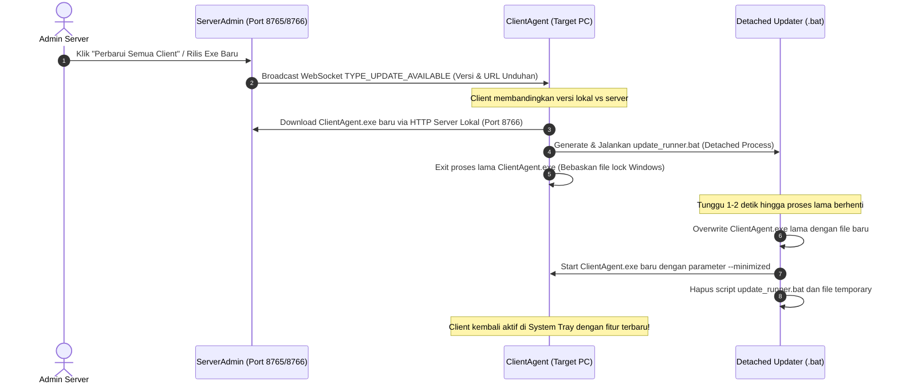

# Workflow: Client Auto-Updater Architecture & Implementation

Workflow ini berisi blueprint, rancangan teknis, dan langkah-langkah implementasi fitur **Auto-Update Otomatis & Senyap** untuk aplikasi PC Client (`ClientAgent.exe`). Disimpan untuk referensi diskusi dan eksekusi pada tahap berikutnya.

---

## 🎯 Tujuan Fitur
Memungkinkan Admin untuk merilis dan memperbarui fitur `ClientAgent.exe` di seluruh komputer target secara massal, senyap (silent), langsung dari Server Admin melalui jaringan lokal (LAN/WiFi), tanpa perlu mendatangi PC target satu per satu, dan tanpa memunculkan jendela di layar target (tetap terminimalkan di System Tray).

---

## 🏗️ Arsitektur & Alur Kerja (Workflow)



---

## 📋 Komponen & Modifikasi Teknis

### 1. Protokol Komunikasi (`shared/protocol.py`)
- Tambahkan konstanta versi:
  ```python
  APP_VERSION = "1.1.0"
  ```
- Tambahkan tipe pesan:
  ```python
  TYPE_UPDATE_AVAILABLE = "UPDATE_AVAILABLE"
  TYPE_UPDATE_PROGRESS = "UPDATE_PROGRESS"
  ```
- Payload `TYPE_UPDATE_AVAILABLE`:
  ```json
  {
      "version": "1.1.0",
      "download_url": "http://192.168.1.50:8766/ClientAgent.exe",
      "changelog": "Pembaruan performa dan fitur baru"
  }
  ```

---

### 2. Mini HTTP Update Server di Admin (`server/server_core.py`)
- Jalankan thread `http.server.SimpleHTTPRequestHandler` ringan di port `8766` yang menyajikan folder `dist/` (hanya `ClientAgent.exe`).
- Tambahkan method `broadcast_update(version: str)` untuk mengirim sinyal ke semua client yang terhubung.
- Catat versi masing-masing client di tabel monitoring Server Admin.

---

### 3. Modul Self-Update Client (`client/updater.py`)
Mengatasi kendala *Windows Executable File-Lock*:
1. Unduh file baru ke `%LOCALAPPDATA%\RemotePCWebMonitor\ClientAgent_new.exe`.
2. Buat script batch `%TEMP%\updater_runner.bat`:
   ```bat
   @echo off
   timeout /t 2 /nobreak > nul
   copy /y "%~1" "%~2" > nul 2>&1
   del "%~1" > nul 2>&1
   start "" "%~2" --minimized
   del "%~f0" > nul 2>&1
   ```
3. Panggil batch script dengan flag `subprocess.CREATE_NO_WINDOW | subprocess.DETACHED_PROCESS`.
4. Hentikan engine dan keluar dari aplikasi (`os._exit(0)`).

---

### 4. Tombol Kontrol di Dashboard Admin (`server/server_gui.py`)
- Tambahkan kolom **"Versi"** di tabel daftar PC Client yang aktif.
- Tambahkan tombol **"🚀 Perbarui Fitur Client"** di bilah dashboard Admin.
- Tampilkan indikator status progres pembaruan client secara real-time.

---

## 📌 Checklist Eksekusi Saat Dilanjutkan
- [ ] Buat modul [`client/updater.py`](file:///c:/xampp/htdocs/remoteweb/client/updater.py)
- [ ] Update [`shared/protocol.py`](file:///c:/xampp/htdocs/remoteweb/shared/protocol.py) dengan tipe pesan update & `APP_VERSION`
- [ ] Integrasikan HTTP file server & broadcast update di [`server/server_core.py`](file:///c:/xampp/htdocs/remoteweb/server/server_core.py)
- [ ] Tambahkan listener update di [`client/client_core.py`](file:///c:/xampp/htdocs/remoteweb/client/client_core.py)
- [ ] Tambahkan tombol update & kolom versi di [`server/server_gui.py`](file:///c:/xampp/htdocs/remoteweb/server/server_gui.py)
- [ ] Compile ulang executable di folder `dist/`
